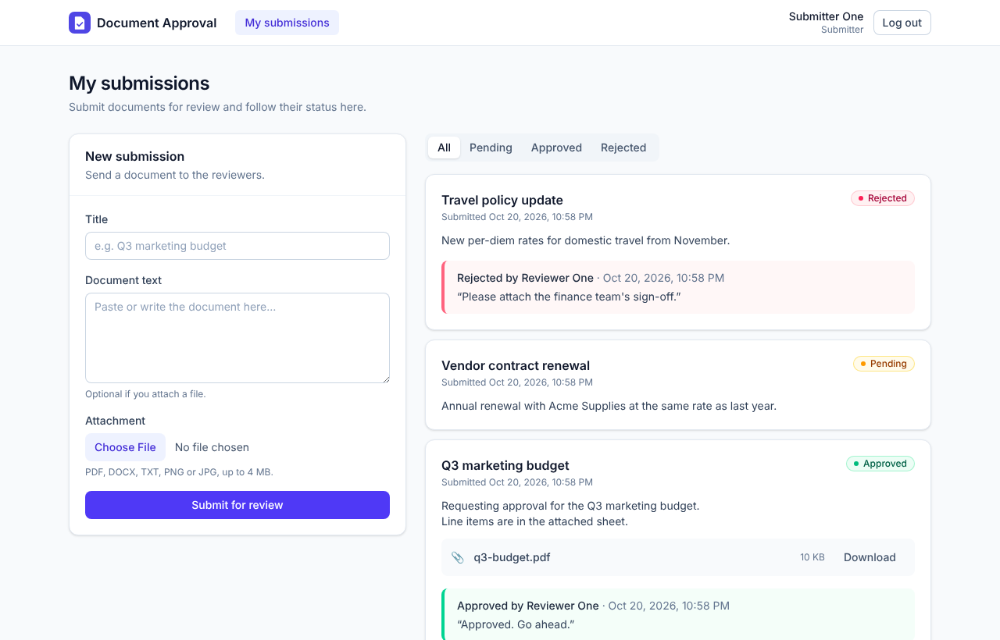
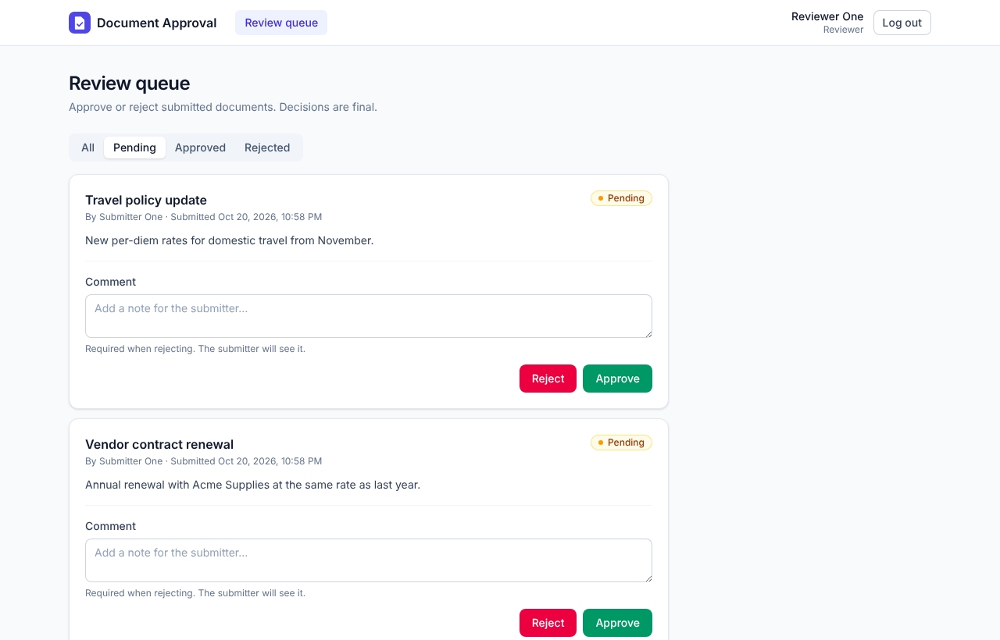
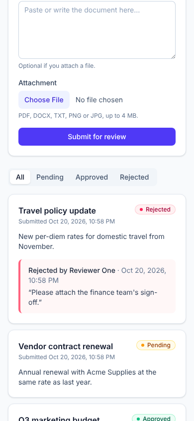
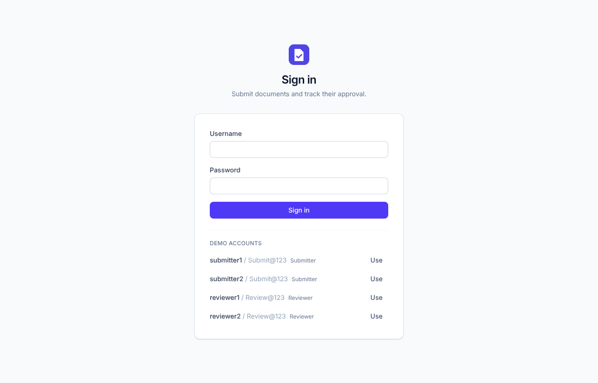
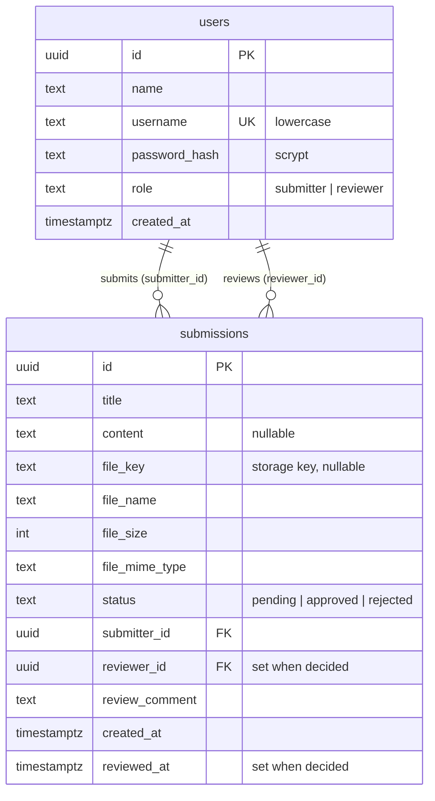
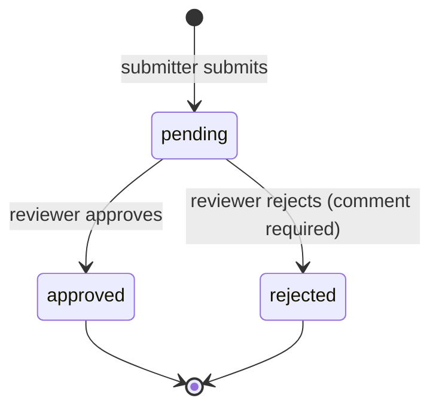

# Document Approval Workflow

A small full-stack app where **submitters** send documents (typed text, a file, or both) for review, **reviewers** approve or reject them with a comment, and submitters track the status.

| Link                     |                                     |
| ------------------------ | ----------------------------------- |
| 🌐 Live demo             | https://document-approval-workflow-kyxh.vercel.app |
| 📘 API docs              | https://document-approval-workflow-rust.vercel.app/api/docs |
| 🎥 Video walkthrough     | adding... |

**Demo accounts** (seeded automatically, also listed on the login page; there is no sign-up in this iteration):

| Role      | Username     | Password     |
| --------- | ------------ | ------------ |
| Submitter | `submitter1` | `Submit@123` |
| Submitter | `submitter2` | `Submit@123` |
| Reviewer  | `reviewer1`  | `Review@123` |
| Reviewer  | `reviewer2`  | `Review@123` |



<details>
<summary>More screenshots (review queue, mobile, login)</summary>





</details>

## Contents

- [What it does](#what-it-does)
- [Tech stack](#tech-stack)
- [Setup and run](#setup-and-run)
- [Tests](#tests)
- [API design](#api-design)
- [Major decisions](#major-decisions)
- [AI tools used](#ai-tools-used)
- [What I'd add for production](#what-id-add-for-production)
- [Project structure](#project-structure)

## What it does

**Submitter**

- Submits a document: a title plus typed text, an attached file (PDF, DOCX, TXT, PNG, JPG, up to 4 MB), or both.
- Sees all of their submissions with status (**pending / approved / rejected**), who decided, when, and the reviewer's comment. Filters by status.

**Reviewer**

- Sees a queue of pending submissions (and can filter to approved, rejected, or all), downloads attached files.
- Approves or rejects. A comment is optional when approving and **required when rejecting**, so the submitter knows what to fix. Decisions are final.

Everyone signs in with a seeded demo account; the app knows each user's role and shows only what that role can do. Self-service sign-up and an admin role are deliberately left for a later iteration (see [What I'd add for production](#what-id-add-for-production)).

UI polish: loading skeletons, empty states, inline field errors, retry on failure, status filters, pagination, session-expiry handling, responsive down to phone width.

## Tech stack

| Layer      | Choice                                                                       | Why                                                                                                       |
| ---------- | ---------------------------------------------------------------------------- | --------------------------------------------------------------------------------------------------------- |
| Language   | TypeScript (strict) everywhere                                               | One language across the stack; the stack I use daily                                                      |
| Backend    | Node 22, Express 5                                                           | Minimal and explicit; Express 5 forwards async errors to the error handler                                |
| Validation | Valibot                                                                      | Small, typed schemas for every request; the same schemas generate the OpenAPI docs                        |
| Database   | PostgreSQL (`pg`) · embedded Postgres ([PGlite](https://pglite.dev)) locally | Relational data with strict rules (foreign keys, CHECK constraints, atomic updates); zero-setup dev/tests |
| Files      | multer → storage interface (local disk / Vercel Blob)                        | Standard Express upload handling; storage is swappable                                                    |
| Auth       | scrypt password hashing (Node built-in) + JWT                                | No native dependencies; stateless tokens                                                                  |
| Frontend   | React 19, Vite, React Router, TanStack Query, Tailwind CSS                   | TanStack Query gives caching, loading and error states with little code                                   |
| Tests      | Vitest, Supertest, React Testing Library, MSW                                | Fast, TypeScript-native, test the real app over HTTP                                                      |
| Tooling    | ESLint, Prettier, GitHub Actions, Docker                                     | Consistent code (`yarn format`) and automated checks on every push                                        |

## Setup and run

**Requirements:** Node.js 22+ and [Yarn Classic](https://classic.yarnpkg.com) (1.x). If you don't have Yarn: `npm install -g yarn` (or `corepack enable`). Docker is optional.

### Option 1: just Node (no database to install)

```bash
yarn install
yarn dev
```

- Frontend: http://localhost:5173 (proxies `/api` to the backend)
- Backend API: http://localhost:3000, Swagger UI at http://localhost:3000/api/docs

With no `DATABASE_URL`, the backend uses **embedded Postgres (PGlite)** stored in `backend/.data/`. On start it applies migrations and seeds the demo users. To wipe all data and re-seed: `yarn db:reset`.

### Option 2: Node + a real Postgres in Docker

```bash
docker compose up -d db pgweb                  # Postgres on :5432, pgweb on :8081
cp backend/.env.example backend/.env           # then uncomment DATABASE_URL
yarn install
yarn dev
```

Browse the tables at http://localhost:8081 (pgweb).

### Option 3: everything in Docker

```bash
docker compose up --build
```

- App (API + built frontend): http://localhost:3000
- pgweb: http://localhost:8081

Uploaded files and the database are kept in Docker volumes.

### Scripts (run from the repo root)

| Command         | What it does                                              |
| --------------- | --------------------------------------------------------- |
| `yarn dev`      | Backend and frontend with hot reload                      |
| `yarn test`     | **All tests** (backend + frontend)                        |
| `yarn format`   | Format all files with Prettier                            |
| `yarn verify`   | Prettier check, ESLint and TypeScript for both workspaces |
| `yarn build`    | Production build of backend and frontend                  |
| `yarn start`    | Run the built backend                                     |
| `yarn db:setup` | Apply migrations and seed demo users (idempotent)         |
| `yarn db:reset` | Delete all data and re-seed demo users                    |

### Environment variables (backend)

All optional for local development. See [`backend/.env.example`](backend/.env.example).

| Variable         | Default             | Purpose                                                        |
| ---------------- | ------------------- | -------------------------------------------------------------- |
| `DATABASE_URL`   | _(embedded PGlite)_ | Postgres connection string                                     |
| `JWT_SECRET`     | dev value           | **Required in production**                                     |
| `PORT`           | `3000`              | API port                                                       |
| `STORAGE_DRIVER` | `local`             | `local` or `blob` (auto `blob` if `BLOB_READ_WRITE_TOKEN` set) |
| `UPLOAD_DIR`     | `backend/uploads`   | Where local uploads go                                         |
| `MAX_UPLOAD_MB`  | `4`                 | Upload size limit                                              |
| `RATE_LIMIT`     | on                  | `off` disables rate limiting                                   |
| `STATIC_DIR`     | _(unset)_           | Serve the built frontend from the API (used by Docker)         |

### Deploying to Vercel

Frontend and backend deploy as **two Vercel projects from the same repo**, each configured by the `vercel.json` inside its own folder:

- **Backend** (`backend/`): the Express API runs as one serverless function, `backend/api/index.js`. Vercel only looks for functions in a folder named `api`, which is why that folder exists.
- **Frontend** (`frontend/`): the built React app, served as static files. Its `vercel.json` forwards `/api/*` to the backend, so the browser talks to one domain and no CORS setup is needed.

Steps:

1. **Backend project.** In Vercel: _Add New → Project_, import the repo, set **Root Directory** to `backend`.
   - In the project's **Storage** tab, add **Neon** (Postgres) and **Blob** (choose private access if asked). Vercel adds `DATABASE_URL` and `BLOB_READ_WRITE_TOKEN` automatically. Both are required: the API refuses to start on Vercel without them, with a clear error.
   - Add an environment variable `JWT_SECRET` (any long random string).
   - Deploy. The build compiles the backend and runs migrations + the demo seed against Neon. Opening the backend URL redirects to the Swagger docs.
2. **Point the frontend at the backend.** In [`frontend/vercel.json`](frontend/vercel.json), replace `REPLACE-WITH-BACKEND-URL.vercel.app` with the backend's URL from step 1, and push.
3. **Frontend project.** Import the same repo again, set **Root Directory** to `frontend`, and deploy. This URL is the live app.

On Vercel, uploads go to Vercel Blob because function disks are temporary, and the upload limit is 4 MB because Vercel caps request bodies at about 4.5 MB.

## Tests

```bash
yarn test
```

One command runs **85 tests**: 61 backend, 24 frontend. No database or browser needs to be installed: backend tests run the real Express app against an in-memory Postgres (PGlite), and frontend tests mock the API with MSW.

Tests live **next to the code they test** as `*.spec.ts` / `*.spec.tsx` (e.g. `submission-status.spec.ts` beside `submission-status.ts`). Specs are excluded from the production build. Shared test helpers live in each app's `src/test/` folder.

**Backend** (`backend/src/**/*.spec.ts`)

- **Unit** (e.g. `password.spec.ts`, `submission-status.spec.ts`): configuration rules (e.g. refuses to start on Vercel without a database or Blob storage), status state machine, password hashing (salting, malformed hashes), JWT (expiry, tampering, wrong secret), role permissions, input schemas (normalisation, a clear message for each missing or invalid field).
- **Integration** (`*.routes.spec.ts`, using Supertest): every endpoint's happy path and error codes: 400, 401, 403, 404, 409, 413, 415, 429.
- **Edge cases:**
  - Two reviewers deciding at the same moment: exactly one wins, the other gets 409.
  - A submitter opening someone else's submission gets 404.
  - A reviewer trying to submit, or a submitter trying to review (403).
  - Role changes taking effect immediately (the role is read from the database on every request).
  - Invalid statuses blocked by the database itself.
- **End-to-end workflows** (`app.workflow.spec.ts`) through real logins: submit with a file → reviewer sees it pending → approve → submitter sees approved; submit text → rejected with a reason → submitter sees why.

**Frontend** (`frontend/src/**/*.spec.tsx`), rendering the whole app:

- Login validation and server errors, demo-account shortcuts.
- Role-based landing pages and navigation, route guards, session expiry, logout.
- Submitting text + file, client-side file limits, server field errors.
- Status display, filtering, empty and error states with retry.
- Approve/reject, required reject comment, "already reviewed" (409).
- The API client builds the multipart upload correctly, sends the token, and turns error responses into typed errors (`endpoints.spec.ts`).

CI (GitHub Actions) runs format check, lint, typecheck, all tests on **Node 22 and Node 24**, both builds and a Docker build on every push and pull request.

## API design

Interactive docs: **`/api/docs`** (Swagger UI). The raw OpenAPI 3 spec is at `/api/openapi.json`; its request schemas are generated from the same Valibot schemas the routes validate with, so the docs can't drift from the code.

**Conventions**

- Auth: `Authorization: Bearer <token>` from `POST /api/auth/login`.
- Every error has the same shape, with a stable `code` the frontend can branch on:

```json
{
  "error": {
    "code": "VALIDATION_ERROR",
    "message": "Some fields are invalid.",
    "details": [{ "field": "title", "message": "Title is required." }]
  }
}
```

### Endpoints

| Method | Path                          | Who               | Purpose                                                                       |
| ------ | ----------------------------- | ----------------- | ----------------------------------------------------------------------------- |
| POST   | `/api/auth/login`             | anyone            | Returns token + user                                                          |
| GET    | `/api/auth/me`                | signed in         | Current user (restores a session on page load)                                |
| POST   | `/api/submissions`            | submitter         | Submit a document (`title`, optional `content`, optional `file`)              |
| GET    | `/api/submissions`            | signed in         | List, newest first. `?status=&page=&pageSize=`. Submitters only see their own |
| GET    | `/api/submissions/:id`        | owner or reviewer | One submission                                                                |
| GET    | `/api/submissions/:id/file`   | owner or reviewer | Download the attachment                                                       |
| PATCH  | `/api/submissions/:id/status` | reviewer          | Approve or reject: `{ "status": "approved" \| "rejected", "comment"? }`       |
| GET    | `/api/health`                 | anyone            | Health check (also checks the database)                                       |

**Example: approve a submission**

```http
PATCH /api/submissions/7f6c…/status
Authorization: Bearer eyJ…
Content-Type: application/json

{ "status": "approved", "comment": "Looks good" }
```

```json
{
  "submission": {
    "id": "7f6c…",
    "title": "Q3 marketing budget",
    "content": "Requesting approval for…",
    "file": { "name": "q3-budget.pdf", "size": 10240, "mimeType": "application/pdf" },
    "status": "approved",
    "submitter": { "id": "…", "name": "Submitter One", "username": "submitter1" },
    "reviewer": { "id": "…", "name": "Reviewer One", "username": "reviewer1" },
    "reviewComment": "Looks good",
    "createdAt": "2026-10-20T08:19:02.123Z",
    "reviewedAt": "2026-10-20T08:21:40.456Z"
  }
}
```

List responses are wrapped with paging info: `{ "items": [...], "page": 1, "pageSize": 10, "total": 23, "totalPages": 3 }`.

### Status codes

| Code | When                                                                              |
| ---- | --------------------------------------------------------------------------------- |
| 400  | Invalid body/query/id, no text and no file, rejecting without a comment, bad JSON |
| 401  | Not signed in, invalid or expired token, wrong username/password                  |
| 403  | Your role doesn't allow this (e.g. a reviewer submitting, a submitter reviewing)  |
| 404  | Not found, **or someone else's submission** (so its existence isn't revealed)     |
| 409  | Already reviewed: decisions are final                                             |
| 413  | File too large                                                                    |
| 415  | File type not allowed                                                             |
| 429  | Too many login or upload attempts                                                 |

## Major decisions

### Data model



The database enforces the core rules itself, not just the code:

- `CHECK` constraints: status and role must be known values; a submission must have text **or** a file; reviewer and review time are set **if and only if** a decision was made.
- Foreign keys from submissions to users; a unique, lowercase `username`.
- Indexes for the two main queries: by status (reviewer queue) and by submitter (my submissions), newest first.
- UUID primary keys, so ids in URLs can't be guessed or enumerated.
- File bytes live in storage (disk / Vercel Blob); the table only holds the key and metadata.

### Status transitions



- The allowed transitions are one table in [`submission-status.ts`](backend/src/submissions/submission-status.ts). Adding a step later (e.g. "changes requested → pending") is a change to that table.
- Decisions are **final**. The decision is written with a single atomic statement:

  ```sql
  UPDATE submissions SET status = $2, reviewer_id = $3, ... WHERE id = $1 AND status = 'pending'
  ```

  If two reviewers click at the same moment, exactly one row update succeeds; the other gets `409 ALREADY_REVIEWED`. No locks or race windows (tested).

### Roles and permissions

| Permission          | Submitter | Reviewer |
| ------------------- | :-------: | :------: |
| Create submissions  |    ✅     |          |
| See own submissions |    ✅     |          |
| See all submissions |           |    ✅    |
| Approve / reject    |           |    ✅    |

The mapping lives in one file ([`permissions.ts`](backend/src/auth/permissions.ts)), and code checks permissions, never role names. The token only stores the user id; the role is read from the database on each request, so a role change takes effect immediately. Adding an admin role later is one new entry in that map.

### Architecture

```
routes (HTTP: parse + validate input, shape responses)
  → services (business rules: who can do what, state transitions)
    → repositories (SQL only)
```

- Dependencies are passed in (`createApp({ config, db, storage })`) rather than imported as globals. That's what lets the tests run the real app on an in-memory database and storage, and lets the same code run on local Postgres, embedded Postgres, or Neon.
- Two small interfaces keep infrastructure swappable: `Database` (pg / PGlite) and `FileStorage` (local disk / Vercel Blob / in-memory). Adding S3 means writing one new `FileStorage`.

### Key trade-offs

| Decision                               | Why                                                                                                                              | Trade-off                                                                      |
| -------------------------------------- | -------------------------------------------------------------------------------------------------------------------------------- | ------------------------------------------------------------------------------ |
| Node/TypeScript instead of Django      | The brief allows any stack; TypeScript, React and Node are what I use in production, so the code is idiomatic and easy to extend | Not the recommended stack                                                      |
| REST only (no GraphQL)                 | Small, fixed API; proper status codes; Swagger; simple file upload                                                               | Clients can't pick fields, which this app doesn't need                         |
| PostgreSQL + embedded PGlite           | Real SQL constraints and atomic updates; `yarn install && yarn dev` works without installing a database                          | PGlite is single-process (dev and tests only, never production)                |
| JWT in `localStorage`                  | Simple, stateless, works the same locally and on Vercel                                                                          | Readable by XSS; production should use httpOnly cookies (see below)            |
| Files in storage, metadata in Postgres | Keeps the DB small; storage can move to S3                                                                                       | A failed insert could leave an orphan file (handled by deleting it on failure) |
| 4 MB upload limit                      | Vercel's ~4.5 MB request cap                                                                                                     | Bigger files need direct-to-storage uploads (presigned URLs)                   |
| In-memory rate limiting                | No extra infrastructure                                                                                                          | Per instance; needs Redis with several instances or on serverless              |
| Refetch on window focus, no websockets | Simple; reviewers see new items when they return to the tab                                                                      | Not instant                                                                    |
| Decisions are final                    | Matches the brief's three statuses; easy to reason about                                                                         | No resubmission flow yet (a natural next iteration)                            |

**Time budget and scope.** The brief suggests about 2 hours, so the app implements exactly the requested feature set: submit, track status, review, validation, error states and tests. User management is out of scope: accounts are seeded, and sign-up / an admin role are listed as next steps below. The extras are kept outside the app logic: Docker, CI and Vercel deployment (a bonus item), so the core stays small and easy to build on.

## AI tools used

- **Claude (Anthropic)**, my main assistant for this project:
  - **Design discussion:** compared stacks (Django vs Node/TS), REST vs GraphQL, Postgres vs NoSQL, Zod vs Valibot, password hashing options, and Vercel's constraints. I made the final calls: REST only, Postgres, Valibot, keeping scope to the brief (seeded logins instead of sign-up/admin), no Playwright for this iteration, and deploying to Vercel.
  - **Implementation:** generated the project scaffolding, backend modules, React components, Docker/CI/Vercel configuration and this README, following the architecture we agreed on.
  - **Tests:** wrote the unit, integration and component tests, including the edge cases.
  - **Debugging:** e.g. PGlite needing its data folder created first, jsdom/MSW quirks with file uploads in tests, and Yarn 1 installing root dev tools in production Docker builds.
- **How the output was checked:** the full test suite, lint, typecheck and production builds; the API exercised with real HTTP requests (including file uploads and the Postgres wire protocol path used in production); and the UI driven in a real browser for every role and on mobile.

## What I'd add for production

**User management (the natural next iteration)**

- **Self-service sign-up.** New accounts always start as **submitters**; the sign-up endpoint accepts no role, so nobody can give themselves approval rights.
- **An admin role** with a Users page to appoint reviewers and change roles. Two guards: the last admin can't be demoted (or nobody could manage roles again), and a reviewer can't review their own submission (possible once a submitter can be promoted).
- How it fits the current design: one new role in `permissions.ts`, a `users` routes/service module next to `submissions`, and a `role` check constraint update in a new migration. The frontend already shows navigation by permission, so a Users page appears only for admins.

**Security**

- httpOnly, `SameSite` cookies (plus CSRF protection) instead of `localStorage` tokens; short-lived access tokens with refresh tokens.
- SSO (Google / Okta) for staff, password reset by email, account lockout after repeated failures, Argon2id hashing.
- A strict Content Security Policy (currently off for the CDN-hosted Swagger UI).
- File safety: check the real file type from its bytes (not the browser's claim) and virus-scan uploads.

**Scale and reliability**

- Direct-to-storage uploads with presigned URLs (S3 or Blob) for large files.
- Redis-backed rate limiting.
- A migration tool (e.g. node-pg-migrate) with down-migrations.
- Cursor pagination and search.
- Database backups.

**Product**

- An audit log table recording every status change (who, when, from → to).
- A "changes requested" state so submitters can revise and resubmit.
- Email or Slack notifications on decisions; assigning reviewers.
- Multiple files per submission, in-browser preview.

**Operations**

- Structured logging with request IDs (pino), error tracking (Sentry), metrics and alerting.
- Separate staging and production environments with preview deployments per pull request.
- Playwright end-to-end tests in CI against a deployed preview; coverage reporting.

**Accessibility and polish**

- A full keyboard and screen-reader audit.
- Toast notifications, optimistic updates, dark mode.

## Project structure

```
.
├── backend/
│   ├── api/index.js          Vercel serverless entry (wraps the Express app)
│   ├── vercel.json           Vercel config for the backend project
│   ├── src/
│   │   ├── app.ts            Builds the Express app from its dependencies
│   │   ├── server.ts         Long-running server (local, Docker)
│   │   ├── vercel.ts         Serverless handler
│   │   ├── config.ts         Environment variables → typed config
│   │   ├── errors.ts         AppError + error codes
│   │   ├── validation.ts     Valibot → 400 with field details
│   │   ├── auth/             Login, JWT, scrypt, permissions, middleware
│   │   ├── users/            User model and lookups (accounts are seeded)
│   │   ├── submissions/      Status machine, repository, service, routes, uploads
│   │   ├── storage/          FileStorage: local disk, Vercel Blob, in-memory
│   │   ├── db/               Database interface, migrations, seed, CLI
│   │   ├── middleware/       Error handler, rate limiting
│   │   ├── docs/             OpenAPI spec + Swagger UI
│   │   └── test/             Test helpers (app on in-memory Postgres)
│   │   (each *.spec.ts sits next to the file it tests)
├── frontend/
│   ├── vercel.json           Vercel config for the frontend project
│   └── src/
│       ├── api/              Typed API client, one function per endpoint
│       ├── auth/             Auth context, provider, route guard
│       ├── components/       Layout + small UI kit (Button, Field, Card, …)
│       ├── features/         submissions/ (components + data hooks)
│       ├── pages/            One component per route (+ its .spec.tsx)
│       └── test/             MSW server, fixtures, render helper
├── Dockerfile · docker-compose.yml
└── .github/workflows/ci.yml
```
